# Ember Mail (web)

The browser inbox for the self-hosted mail service in [`apps/api`](../api). It has the same features as the
[mobile app](../mobile): team members read and answer `support@`/`privacy@` mail. The UI is in Portuguese (pt-BR) by
default, switches to English when the browser prefers it (or by choice in the account menu), and follows dark mode.

Stack: [Vite+](https://viteplus.dev) (`vp`), React 19, [shadcn/ui](https://ui.shadcn.com) (Tailwind v4, Radix),
Better Auth's client, and Ember's React client (`@freecorps/ember-react` over `@freecorps/ember-client`). It calls the
same `inbox:*` functions as mobile.

## Screenshots

Taken at 1440 × 900 and 375 × 812 from a local `ember dev` with the sample data under [Develop](#develop), a few more
inbound demo conversations and a second teammate (`.test` addresses only), in pt-BR.

| Inbox: tags, assignees, Aguardando                | Conversation: activity, note, signature                   | Compose windows (one open, one minimized)             |
| ------------------------------------------------- | --------------------------------------------------------- | ----------------------------------------------------- |
| 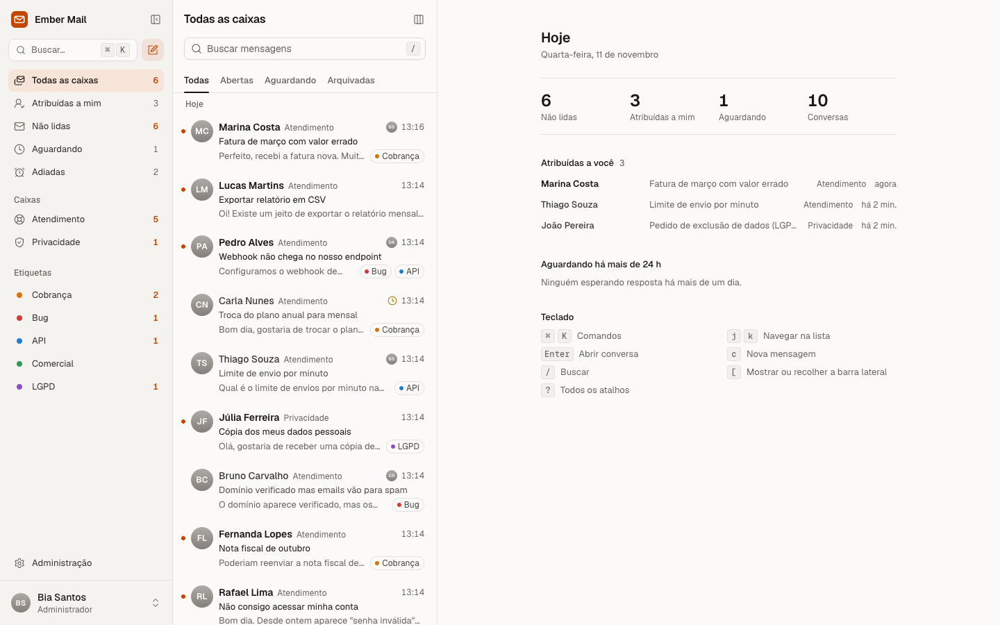 | 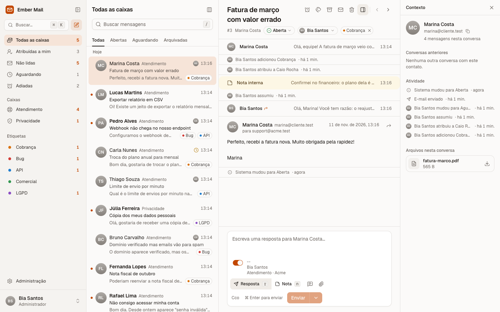 | 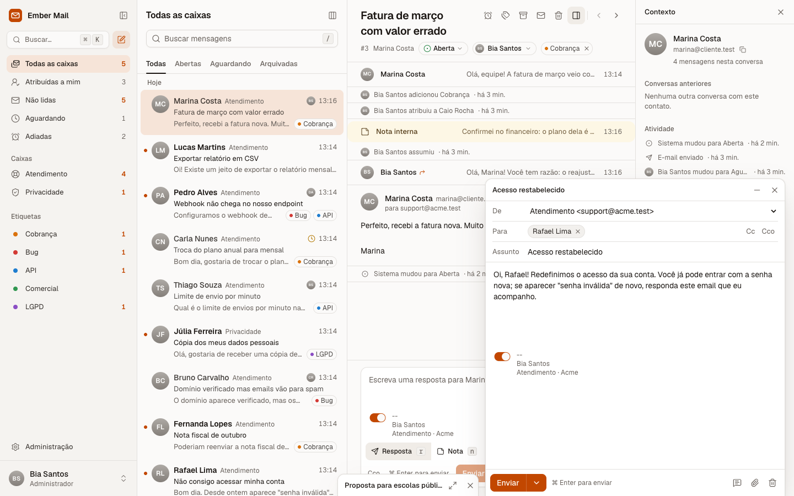 |
| 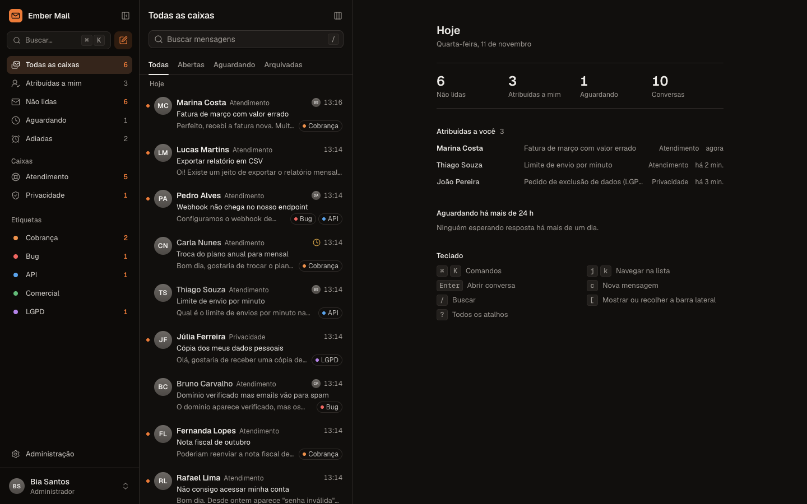   | 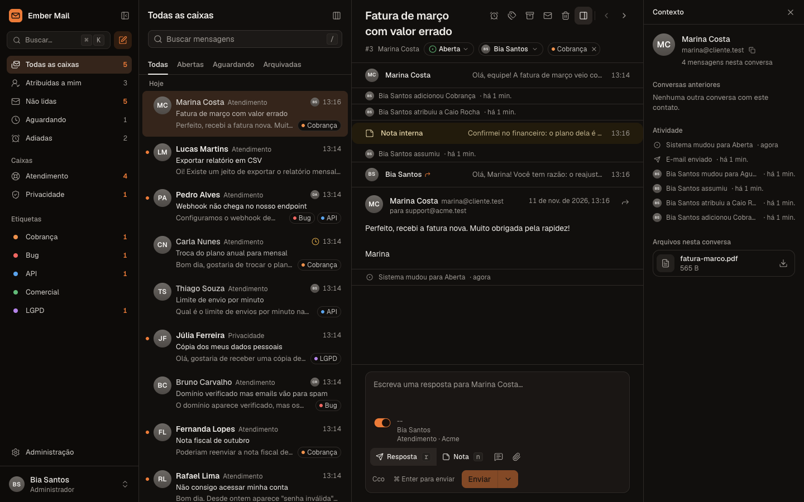   | 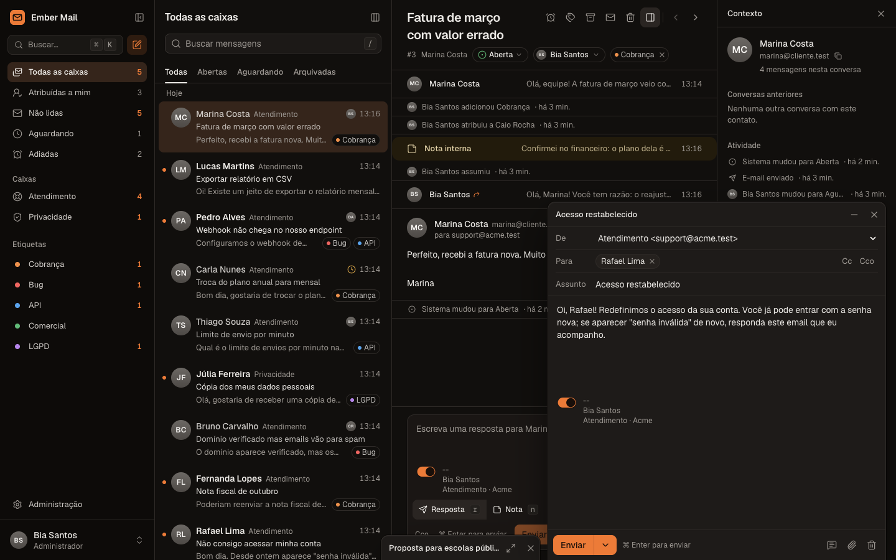   |

| Tag menu (`l`)                                      | ⌘K on the open conversation                                   | Adiadas (snoozed)                                     |
| --------------------------------------------------- | ------------------------------------------------------------- | ----------------------------------------------------- |
| 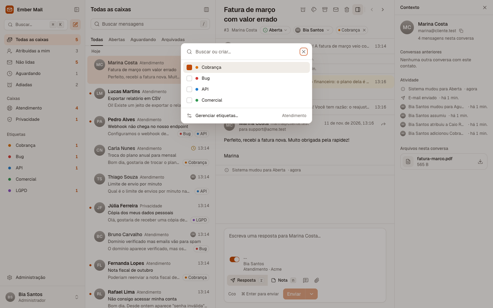 | 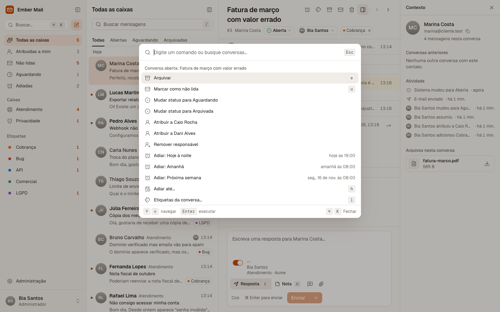 | 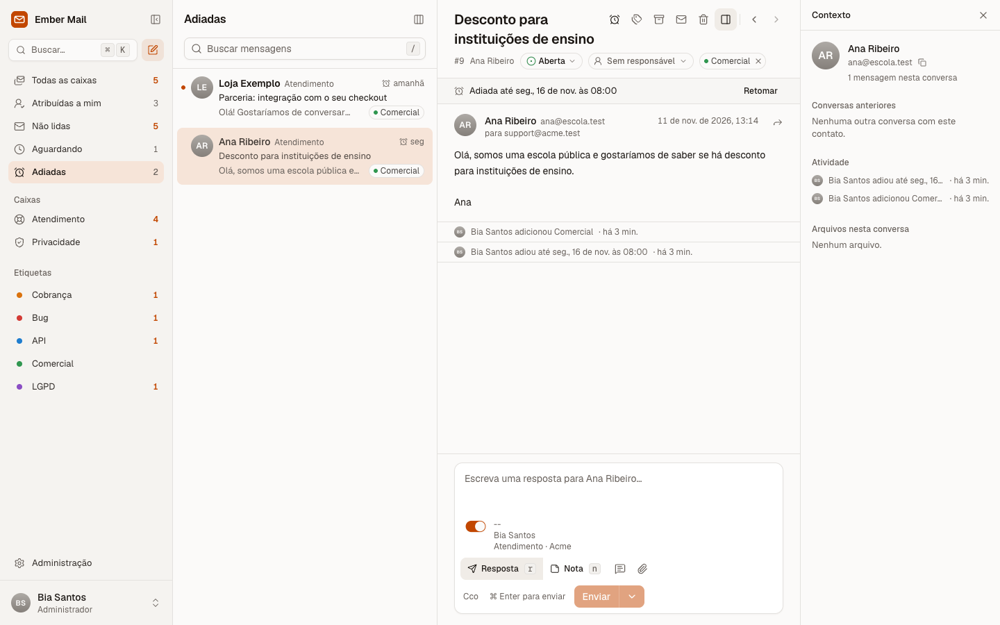 |
| 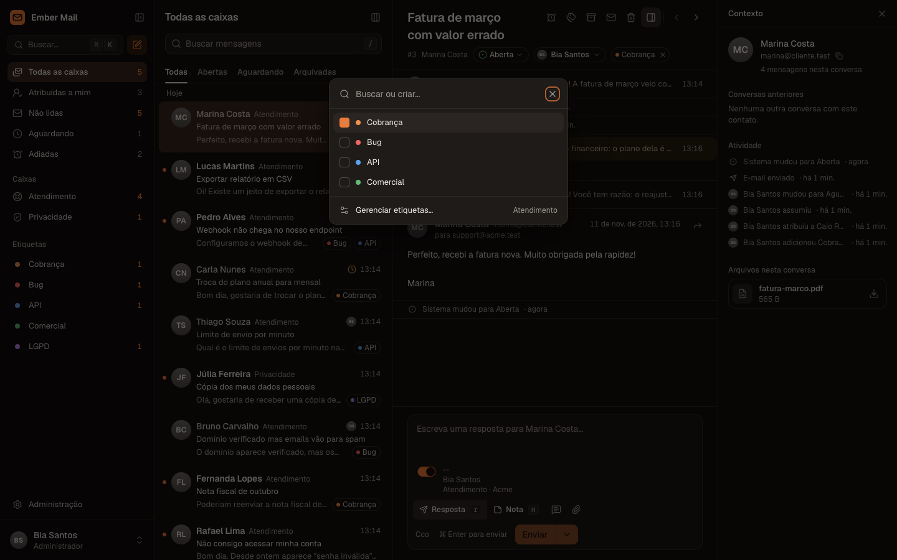   | 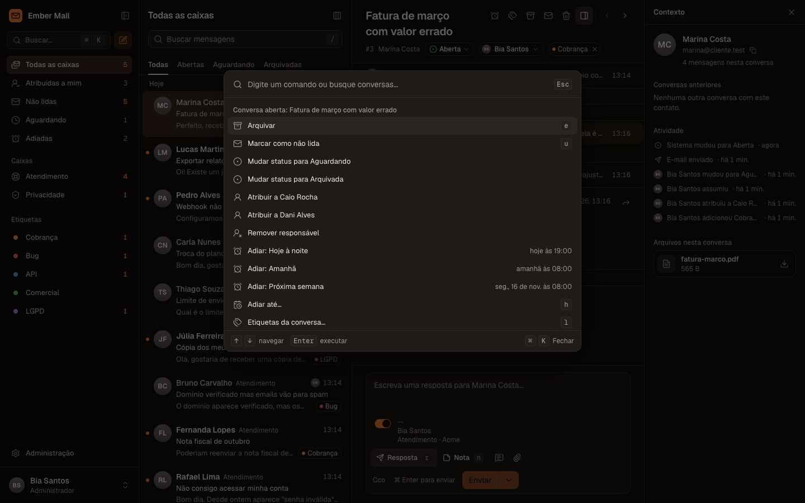   | 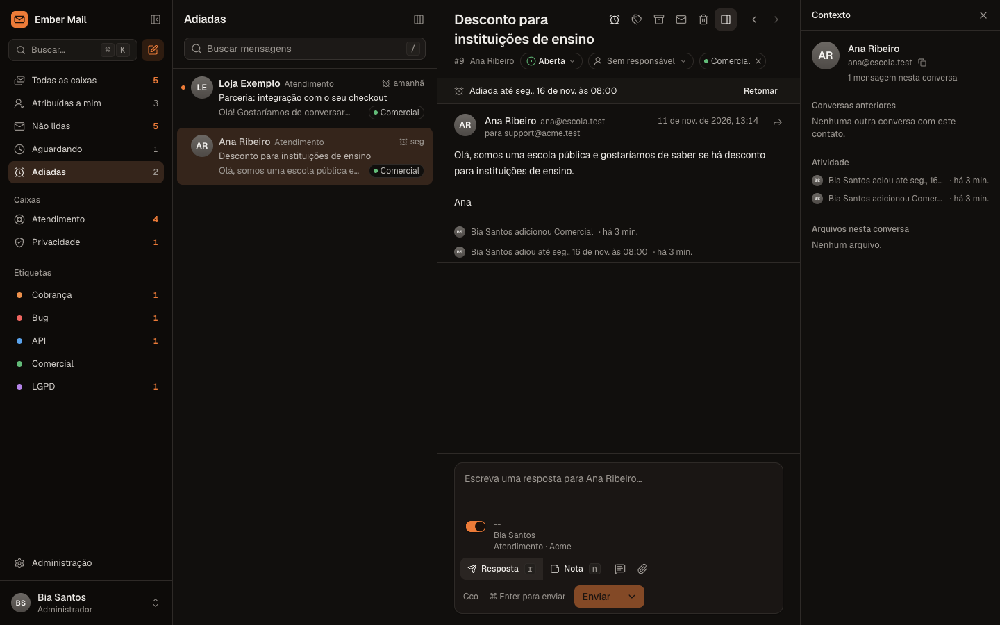   |

| Phone: list                                       | Phone: conversation                                                   | Phone: composer (full screen)                                      |
| ------------------------------------------------- | --------------------------------------------------------------------- | ------------------------------------------------------------------ |
| 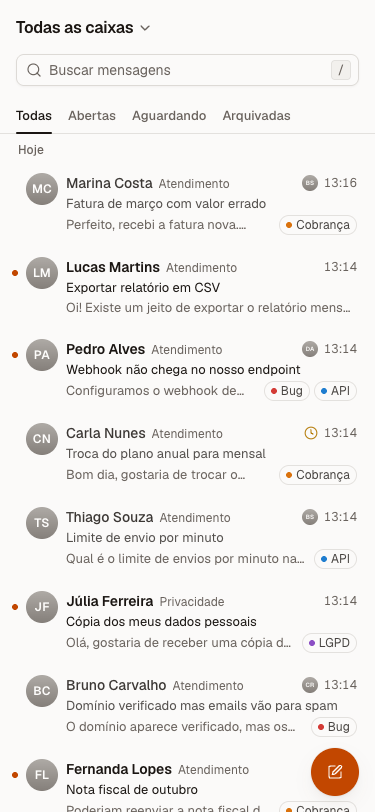 | 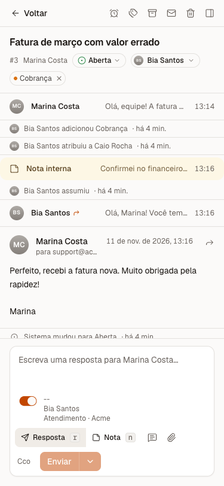 | 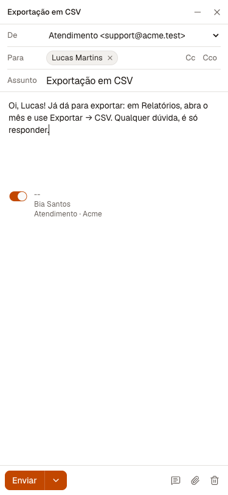 |
| 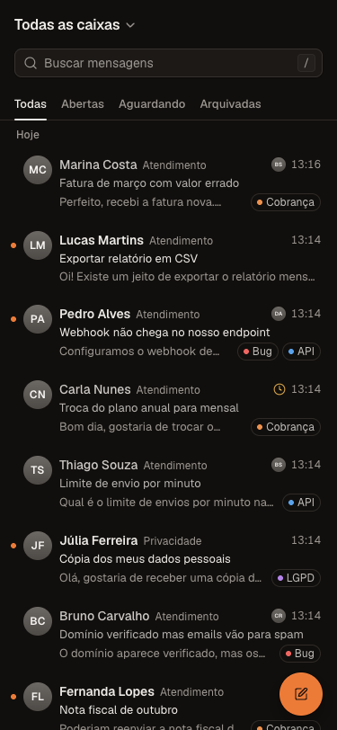   | 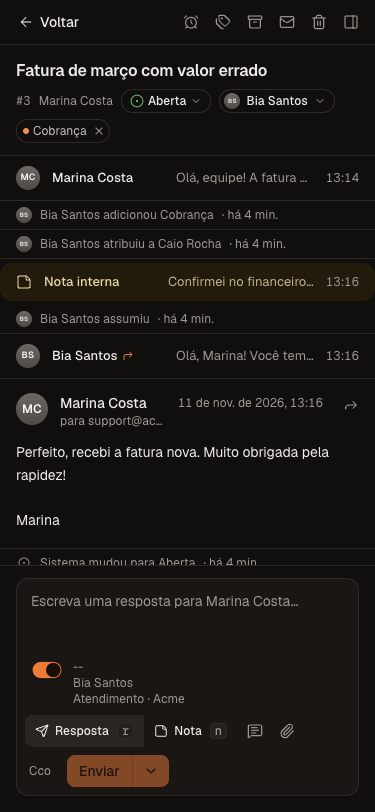   | 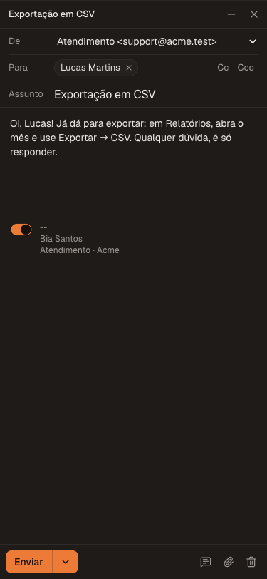   |

The admin screen is under [Administration](#administration).

## Features

|                                   | How                                                                                                                                                                                                                                                                                                                                                                                                                                                                                                                                                                                                                                                                                                                                                                                                                                                                                                                                                                                                                                                                                                                                                                                                                                                                                                                                                                                                                                                                                                         |
| --------------------------------- | ----------------------------------------------------------------------------------------------------------------------------------------------------------------------------------------------------------------------------------------------------------------------------------------------------------------------------------------------------------------------------------------------------------------------------------------------------------------------------------------------------------------------------------------------------------------------------------------------------------------------------------------------------------------------------------------------------------------------------------------------------------------------------------------------------------------------------------------------------------------------------------------------------------------------------------------------------------------------------------------------------------------------------------------------------------------------------------------------------------------------------------------------------------------------------------------------------------------------------------------------------------------------------------------------------------------------------------------------------------------------------------------------------------------------------------------------------------------------------------------------------------- |
| Sign-in                           | Better Auth (`better-auth/react` + `jwtClient`) against the mail service's own Auth (`apps/api/ember/auth.config.ts`). The app is served from the API's origin (see "Same origin"), so the session is Better Auth's HttpOnly cookie and nothing is kept in `localStorage`. Ember gets short JWTs from `GET /api/auth/token`, cached until 30 s before `exp` (`src/lib/auth.ts`). A signed-in user without mailboxes sees their user id to hand to an admin (`POST /inbox/members`).                                                                                                                                                                                                                                                                                                                                                                                                                                                                                                                                                                                                                                                                                                                                                                                                                                                                                                                                                                                                                         |
| Layout                            | Resizable panes (sidebar, list, conversation); the sidebar collapses to an icon rail (`[`, its button, or dragged narrow). Widths, the collapsed state and the reading mode are per-browser prefs: **three panes**; **full-width conversation** (the list and "Hoje", a conversation opens over them); **focus** (a wide list, a conversation opens over it). Below 1024px the conversation always opens over the list, and phones show one pane at a time.                                                                                                                                                                                                                                                                                                                                                                                                                                                                                                                                                                                                                                                                                                                                                                                                                                                                                                                                                                                                                                                 |
| Hoje                              | The empty reading pane: counts per view (`inbox:views`), the threads assigned to you and the ones waiting on the contact for more than 24 h (`inbox:view`), and the main keys.                                                                                                                                                                                                                                                                                                                                                                                                                                                                                                                                                                                                                                                                                                                                                                                                                                                                                                                                                                                                                                                                                                                                                                                                                                                                                                                              |
| Mailboxes                         | Sidebar: the views across mailboxes, as on mobile (Todas as caixas, Atribuídas a mim, Não lidas, Aguardando, Adiadas; `inbox:view`, counts from `inbox:views`), then the mailboxes (`inbox:mailboxes`, unread counts), with Enviadas and Spam (when there is any) under the current one, then Etiquetas (every tag the member sees, unread count from `inbox:views` `tags`; `?g=<tagId>` lists a tag's threads). The tab title carries the total, for example `(3) Ember Mail`. On phones the sidebar becomes a picker in the list header.                                                                                                                                                                                                                                                                                                                                                                                                                                                                                                                                                                                                                                                                                                                                                                                                                                                                                                                                                                  |
| Threads                           | `inbox:threads` (or `inbox:view` in a view, each row naming its mailbox), with the statuses (all / open / waiting / archived) as underlined tabs. Rows: a neutral monogram, the sender (bold when unread), the time, the subject and a preview; status as a small glyph (clock, archive box, shield) only where the list mixes statuses, the assignee as a mini monogram. Rows sit under sticky day headers (Hoje, Ontem, Esta semana, then by month), are virtualized (`@tanstack/react-virtual`) and the next page of 30 loads as the end scrolls into view. On hover the time gives way to archive, read/unread and assign.                                                                                                                                                                                                                                                                                                                                                                                                                                                                                                                                                                                                                                                                                                                                                                                                                                                                              |
| Search                            | `inbox:search` on the server (debounced, two characters or more), scoped to the mailbox, or across all of them in a view, with one row per thread.                                                                                                                                                                                                                                                                                                                                                                                                                                                                                                                                                                                                                                                                                                                                                                                                                                                                                                                                                                                                                                                                                                                                                                                                                                                                                                                                                          |
| Location                          | View or mailbox, filter, search and open thread live in the URL (`?v=assigned` or `?m=support&f=open`, then `&q=…&t=<thread>`; `f=sent` and `f=spam` are the mailbox Sent and Spam lists), so reload, back/forward and shared links all work.                                                                                                                                                                                                                                                                                                                                                                                                                                                                                                                                                                                                                                                                                                                                                                                                                                                                                                                                                                                                                                                                                                                                                                                                                                                               |
| Thread view                       | One column of messages separated by hairlines (no cards): older messages collapse to a line (who, a preview, when) and a long conversation folds its middle behind "N mensagens anteriores"; the latest is open. Sent messages carry a small ember arrow, internal notes are tinted blocks. Quoted text (Gmail `gmail_quote`, Apple Mail/Thunderbird `blockquote type=cite`, Outlook headers, "Em … escreveu:"/"On … wrote:" + `>` lines) collapses behind "•••" (`@freecorps/mail-email-html/quote`, shared with mobile); list previews drop the quote too. The header has status and assignee as menus, archive, read/unread, the context panel and previous/next. The open conversation stays mounted when the reading mode or the breakpoint changes (a portal its slot adopts, `components/Reparent.tsx`). Plain-text bodies render as text, and only http(s) and mailto links become clickable. HTML mail renders in an `<iframe srcdoc>` sandboxed to `allow-same-origin allow-popups allow-popups-to-escape-sandbox`: no `allow-scripts`, no forms, no top navigation. A CSP meta tag comes first in its `<head>` (`script-src 'none'`, `connect-src 'none'`, images only from `data:` and the inline attachments). A sanitizer runs as well (`src/lib/emailHtml.ts`, the same rules as mobile). Remote images, including tracking pixels and remote CSS, are blocked until you click **Carregar imagens**. Links open in a new tab with `noopener noreferrer`. The frame grows to fit its content. |
| Attachments                       | `inbox:attachments` returns signed, short-lived `files` URLs (download links). Inline `cid:` images are resolved into the HTML.                                                                                                                                                                                                                                                                                                                                                                                                                                                                                                                                                                                                                                                                                                                                                                                                                                                                                                                                                                                                                                                                                                                                                                                                                                                                                                                                                                             |
| Reply, note, compose              | `inbox:reply` / `inbox:note` / `inbox:compose` / `inbox:forward`, optimistic with the same rules as mobile (`src/lib/optimistic.ts`). The editor is TipTap (StarterKit with Link, no headings, a lazy chunk preloaded on idle): a formatting bar on selection, ⌘/Ctrl+Enter sends `bodyHtml` (Ember sanitizes it) and a text/plain part written from the document (`lib/editorText.ts`). A reply passes a localized `quoteHeader` ("Em 5 de nov. de 2026 às 10:12, Marina Costa escreveu:"). Files go up by drop, paste or the clip, straight to storage (`inbox:generateUploadUrl`, as on mobile); sending waits for them. "Nova mensagem" and forwards open as windows docked bottom right (up to three, minimizable, full screen on phones) with Para/Cc/Cco as chips and suggestions from recent conversations (`inbox:recent`); the reply box has Cco too.                                                                                                                                                                                                                                                                                                                                                                                                                                                                                                                                                                                                                                             |
| Drafts, signatures, saved replies | Drafts autosave to the server a second after typing stops (`inbox:saveDraft`; nothing in browser storage), come back when the conversation opens (and compose drafts from ⌘K → Rascunhos), and a send consumes them (`draftId`). The signature (per mailbox, else the default) previews under the editor with a switch per message; account menu → Assinaturas edits them, starting from "Nome / Nome da caixa". Saved replies insert with `/` in the editor or the button, their `{nome}`, `{primeiro_nome}`, `{email}`, `{caixa}`, `{agente}`, `{numero}` filled (`fillSavedReply`); a manager creates and edits them (author or admin).                                                                                                                                                                                                                                                                                                                                                                                                                                                                                                                                                                                                                                                                                                                                                                                                                                                                  |
| Undo send                         | Account menu → Desfazer envio: 0, 5 (default), 10 or 20 s. Until then the conversation shows the message as scheduled and **Desfazer** (there and in the toast) puts it back in the composer; nothing has reached the server. Leaving the page during that window asks first.                                                                                                                                                                                                                                                                                                                                                                                                                                                                                                                                                                                                                                                                                                                                                                                                                                                                                                                                                                                                                                                                                                                                                                                                                               |
| Tags                              | Per mailbox (`inbox:tags`). Chips on the row (preview line; subject line in compact) and in the conversation header (× removes). `l` or the header's button opens the tag menu: search (accents ignored), toggle, create inline with a color; a selection of one mailbox gets it from the bulk bar. Settings (account menu → Etiquetas, ⌘K, the sidebar): rename in place, color, order, delete with the count of conversations it leaves. Optimistic, with Desfazer on removal; tag counts follow (`lib/optimistic.ts`).                                                                                                                                                                                                                                                                                                                                                                                                                                                                                                                                                                                                                                                                                                                                                                                                                                                                                                                                                                                   |
| Snooze                            | `h` (the selection, else the open conversation, else the cursor's row), the row's hover action, the header and ⌘K: Hoje à noite (until 18:00), Amanhã, Próxima semana, or a date and time, in the member's time zone (`lib/when.ts`), up to 366 days. A snoozed thread leaves every list and count but Adiadas (soonest to wake first, "até amanhã" in the row) and mailbox badges count it apart, as Ember 0.7 does; the conversation says "Adiada até …" with Retomar. Desfazer in the toast.                                                                                                                                                                                                                                                                                                                                                                                                                                                                                                                                                                                                                                                                                                                                                                                                                                                                                                                                                                                                             |
| Scheduled send                    | The arrow next to Enviar (reply box and windows) or ⌘/Ctrl+Shift+Enter: tomorrow 08:00 or 13:00, Monday 08:00, or a date and time (`sendAt`). The message shows at once as "Agendada para …" with Editar (cancel and back into the composer, or a window for a new conversation) and Cancelar envio (`inbox:cancelScheduled`). Past 10 MB of files in all (they would go as links, which expire) the option is blocked beforehand with why; files restored from a draft have no known size, so the server's refusal is shown in the same words.                                                                                                                                                                                                                                                                                                                                                                                                                                                                                                                                                                                                                                                                                                                                                                                                                                                                                                                                                             |
| Activity and presence             | `inbox:activity` merged between the messages, quietly ("Bia Santos atribuiu a Caio · há 2 h": what people did, not what a message caused), and in full in the context panel (newest first). Presence: a heartbeat every 10 s while the conversation is open and the tab visible (`replying` while the reply box has focus or text, settling back after 4 s), `null` on leaving or hiding; the header shows "Caio está vendo" / "Caio e Dani estão respondendo…" with stacked monograms.                                                                                                                                                                                                                                                                                                                                                                                                                                                                                                                                                                                                                                                                                                                                                                                                                                                                                                                                                                                                                     |
| Read / unread, archive, assign    | Opening a thread marks it read. `u` marks it unread. `e` archives or unarchives (`closed` ⇄ `open`), with **Desfazer** in the toast: the thread goes back to its status and into the lists that dropped it (the same `rejoin` rule as mobile). The assign menu lists the members who can see the mailbox (`inbox:members`). All of these are optimistic.                                                                                                                                                                                                                                                                                                                                                                                                                                                                                                                                                                                                                                                                                                                                                                                                                                                                                                                                                                                                                                                                                                                                                    |
| Multi-select                      | The avatar is the row's checkbox (it turns into one on hover, and a tap selects on touch screens); `x` selects the cursor's row, shift-click a range, `shift+j`/`shift+k` extend, and the bulk bar selects all loaded rows. The bar archives (with Desfazer), marks read/unread and assigns (across mailboxes, only people who see all of them). There is no bulk mutation: the client runs one optimistic mutation per thread. `Esc` clears.                                                                                                                                                                                                                                                                                                                                                                                                                                                                                                                                                                                                                                                                                                                                                                                                                                                                                                                                                                                                                                                               |
| Delete                            | Admins (shared mailboxes) and owners (their own) delete a conversation for good: messages, notes and files (`inbox:deleteThread`); a reply still queued is canceled.                                                                                                                                                                                                                                                                                                                                                                                                                                                                                                                                                                                                                                                                                                                                                                                                                                                                                                                                                                                                                                                                                                                                                                                                                                                                                                                                        |
| Keyboard                          | `j`/`k` (or ↓/↑) move through the list, and open the next thread when one is already open. `Enter`/`o` opens. `x` selects, `shift+j`/`shift+k` extend the selection. `e` archives (the selection when there is one). `u` marks unread. `h` snoozes, `l` tags. `r` replies. `n` writes a note. `c` composes. `i` shows the context panel. `/` searches. `[` collapses or expands the sidebar. `⌘K` / `Ctrl+K` opens the command palette (go to a view, mailbox or admin section, search conversations, archive / assign / change status on the open one, compose, theme, density, layout), with no open/close animation. `Esc` leaves a field or closes the thread. `?` lists all the shortcuts. Shortcuts keep working after a click inside an email (the frame forwards keys). `⌘/Ctrl+Enter` sends, `⌘/Ctrl+Shift+Enter` sends later. In a compose window `Esc` minimizes it and the inbox keys stay off.                                                                                                                                                                                                                                                                                                                                                                                                                                                                                                                                                                                                 |
| Context panel                     | `i` or the header button: the contact (copy the address), their earlier conversations (`inbox:search` on their address, every mailbox you see) and every file in the conversation. Beside the messages when the pane is at least 760px wide (remembered), over them otherwise (each time).                                                                                                                                                                                                                                                                                                                                                                                                                                                                                                                                                                                                                                                                                                                                                                                                                                                                                                                                                                                                                                                                                                                                                                                                                  |
| Accessibility                     | Semantic landmarks (`nav`, `main`, sections with labels), real buttons and links, Radix menus and dialogs (focus trap, Esc, roving focus), `aria-current` on the open thread and mailbox, screen-reader text for unread state, visible focus rings, and `prefers-reduced-motion`.                                                                                                                                                                                                                                                                                                                                                                                                                                                                                                                                                                                                                                                                                                                                                                                                                                                                                                                                                                                                                                                                                                                                                                                                                           |
| Phone                             | One pane at a time below 768px: the sidebar is a picker in the list header, a floating button composes, the conversation has its actions in the back bar, and below 640px compose windows open full screen. `viewport-fit=cover` with safe-area padding (shell, button, toasts, the compose dock), 16px editor text on touch screens so iOS does not zoom, no long-press selection on controls, and a `theme-color` that follows the chosen theme.                                                                                                                                                                                                                                                                                                                                                                                                                                                                                                                                                                                                                                                                                                                                                                                                                                                                                                                                                                                                                                                          |
| Theme                             | System, light or dark, and a comfortable or compact density, set in the account menu. Both are applied before first paint (`public/theme.js`). Email bodies stay on white, as senders design them. Type scale, radius, elevation, density and motion are tokens in `src/index.css`.                                                                                                                                                                                                                                                                                                                                                                                                                                                                                                                                                                                                                                                                                                                                                                                                                                                                                                                                                                                                                                                                                                                                                                                                                         |

Not in the web inbox: push and the offline replica. Mobile keeps mail on the device. The web keeps nothing in browser
storage, because browsers are often shared.

## Administration

Admins (members with `admin`) get **Administração** in the sidebar and the account menu (`?a=<section>`). It runs on
the `console:*` functions (`apps/api/ember/console.ts`), which check `admin` on every call:

| Section          | What                                                                                                                                        |
| ---------------- | ------------------------------------------------------------------------------------------------------------------------------------------- |
| Visão geral      | Counts, and what the Worker runs: project, environment, Ember release (`EMBER_RUNTIME_VERSION`), Worker version, whether it manages domains |
| Domínios         | Status of sending and receiving, routing rules, DNS records (copy) and what is left; re-check or add when the Worker has a Cloudflare token |
| Caixas           | Personal (owner only) or shared, who has access, retention, auto-reply; create and edit                                                     |
| Pessoas          | Access requests (grant or decline), shared mailboxes per person, admin, remove                                                              |
| Chaves de API    | Active keys (prefix only), create (the token shows once), revoke                                                                            |
| Webhooks         | Endpoints, events and filters, the signing secret on demand, test, rotate, pause, delete; recent deliveries (send again)                    |
| E-mails enviados | A project's send log with each email's delivery events                                                                                      |
| Supressões       | A project's blocked addresses; block and unblock                                                                                            |

A personal mailbox stays its owner's business here too: admins see that it exists and who owns it, never its counts,
its sent emails or its suppressions.

| Light                                                      | Dark                                                     |
| ---------------------------------------------------------- | -------------------------------------------------------- |
| 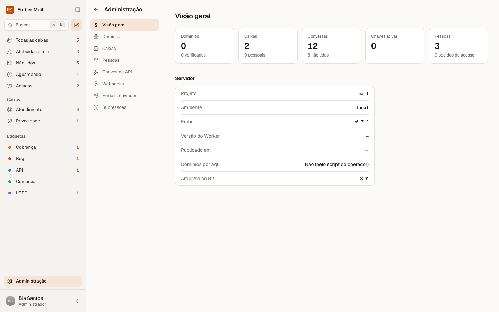 | 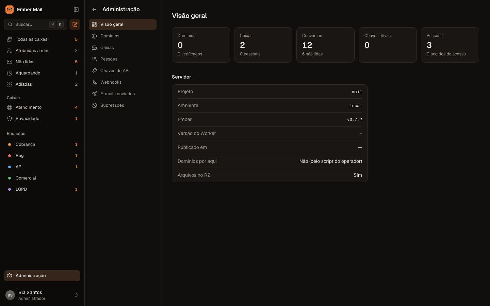 |

## Same origin

The browser talks to one origin. `/api/*` (Better Auth, one-shot Ember calls, signed files) and `/ws` (the Ember
socket) are forwarded to the mail service:

- **Dev:** the Vite+ dev server proxies them (`vite.config.ts`, `MAIL_API_URL`).
- **Production:** a small Worker (`worker/index.ts`) serves `dist/` as static assets and forwards the same paths
  (`run_worker_first`).

The forwarder accepts state-changing requests only from its own origin. It then presents the API's origin, which
Better Auth trusts, so cross-site requests still fail. Security headers for the app (CSP, `nosniff`,
`frame-ancestors 'none'`, …) are in `public/_headers`.

## Develop

Vite+ runs on **Node.js** (the `vp` binary is a Node script, and Vite, Vitest and Oxlint run under Node). Bun
installs and runs the scripts. You need Node `^22.18 || ^24.11 || >=26` (the `vite-plus` engines; CI uses 24) and Bun. The project-local `vite-plus` package
provides `vp`, so the global CLI is optional.

```sh
# terminal 1: the API (any free port)
cd apps/api && EMBER_ADMIN_TOKEN=dev-admin bunx ember dev --port 8790
# terminal 2: sample data (mailboxes, a member bia@acme.test / ember-mail-dev-123, inbound mail)
cd apps/mobile && EMBER_URL=http://127.0.0.1:8790 bun scripts/seed-dev.ts
# terminal 3: the web inbox at http://localhost:5180 (PORT=… for another port)
cd apps/web && MAIL_API_URL=http://127.0.0.1:8790 bun run dev
```

Sign in as `bia@acme.test` / `ember-mail-dev-123`. The seed gives that member both mailboxes and four conversations,
plus a teammate (Caio Rocha) to assign to. To make Bia an admin (for **Administração**), post her again with
`admin: true` (`POST /inbox/members { user_id, name, mailboxes, admin: true }`, `Bearer dev-admin`; the seed prints
the user id). Tags, snoozes, notes and replies are made in the app.

| Script               | What                                                                                                                            |
| -------------------- | ------------------------------------------------------------------------------------------------------------------------------- |
| `bun run dev`        | `vp dev` (HMR, proxy to `MAIL_API_URL`, default `http://127.0.0.1:8787`)                                                        |
| `bun run check`      | `vp check`: Oxfmt and Oxlint (type-aware, with type-check, React, a11y rules)                                                   |
| `bun run typecheck`  | `tsc` for the app, the tests, the config and the Worker                                                                         |
| `bun run test`       | `vp test run`: pure helpers and view models against the real mail service functions on the server engine (`test/mailServer.ts`) |
| `bun run build`      | `vp build` → `dist/`                                                                                                            |
| `bun run worker:dev` | Serves `dist/` through the production Worker locally (`wrangler dev`, set `MAIL_API_URL` with `--var`)                          |

In dev only, `?data=worst` (or `empty`, `one`, `huge`) swaps the sidebar's, Hoje's and the thread list's data for the worst-case fixtures in
`src/dev/fixtures.ts` (long and RTL names, unbreakable addresses, 12,483 unread, capped counts, empty subjects), with a
Demo / Worst case / Empty / One / 1,000 rows switch at the bottom of the screen. A fixture row opens its fixture
conversation (the worst one, `?t=fx_30`, has 20 tags, a paragraph of a subject, 14 Cc, long attachment names, an RTL
note and a 1400px HTML table). Production builds drop it (the fixtures' top level is marked pure, so the bundler can).

The first load is the inbox shell and the list. The conversation, the compose windows, the pickers, the tag menu, ⌘K,
the editor and the admin screen (with its strings) are chunks of their own, fetched while the browser is idle or on
first use.

The root `bun run check` runs typecheck, `vp check`, every test and this build. CI runs the same.

The app has been checked end to end in a real browser against that setup, through the Vite+ proxy and through the
production Worker (`wrangler dev`): sign-in, the lists and counts, `j`/`Enter`, the sandboxed HTML message with its
tracker blocked by CSP, the signed PDF link, reply, note, assign, compose, archive, search and sign-out.

## Deploy (Cloudflare Workers static assets)

Not deployed by CI. Deploy only into your own account:

1. In `worker/wrangler.jsonc`, set `name`, set `MAIL_API_URL` to the mail service's public URL, and if possible
   uncomment the `services` binding to the API Worker (`ember-mail-<env>`), which avoids a public hop.
2. Give the Worker a route or custom domain, for example `inbox.example.com`.
3. `cd apps/web && bun run worker:deploy` (that is `vp build && wrangler deploy -c worker/wrangler.jsonc`).

Cloudflare Pages also works for the static part. It would need a Pages Function doing what `worker/index.ts` does for
`/api/*` and `/ws`; Workers static assets is the simpler path.
